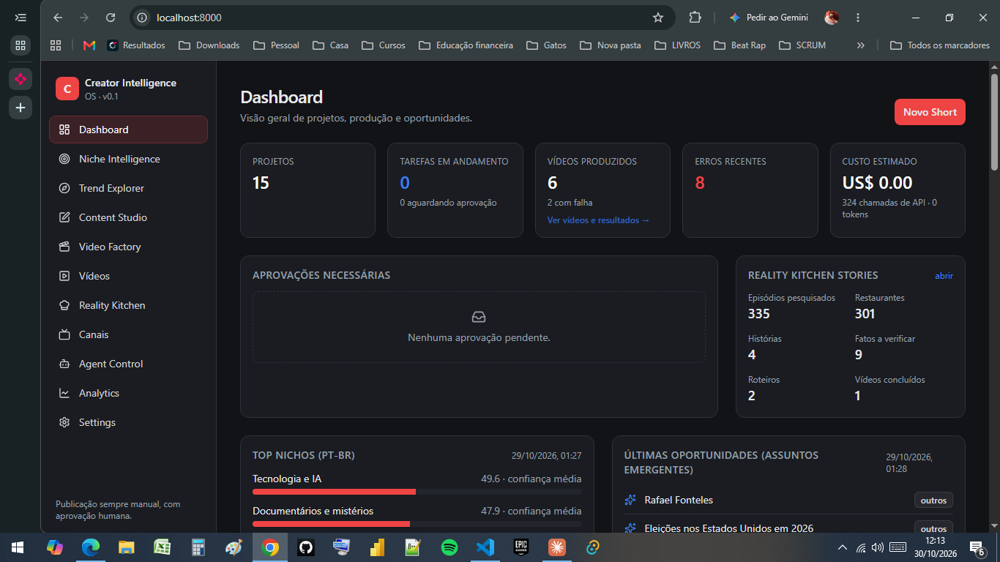
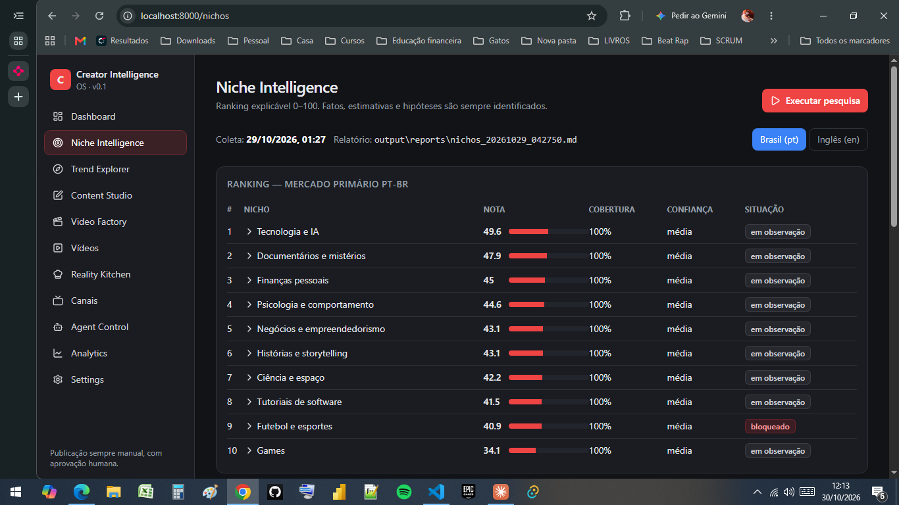
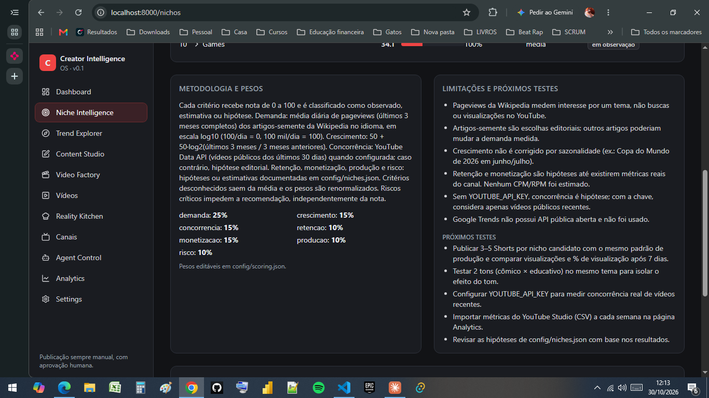
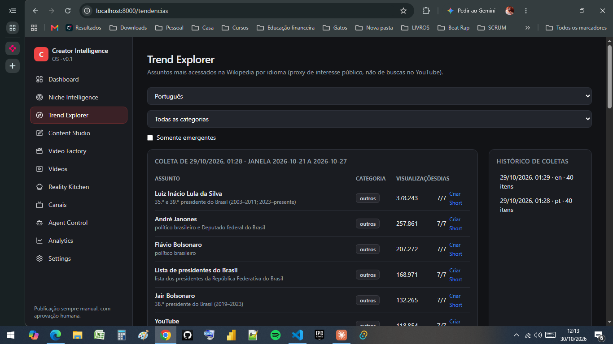
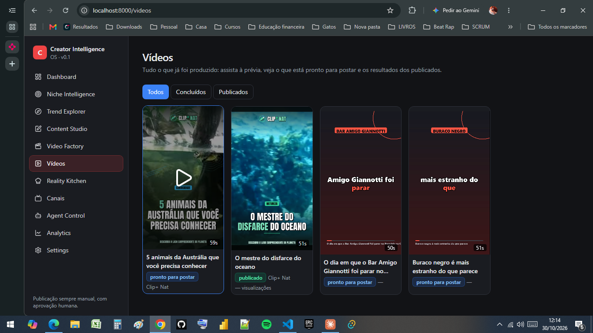
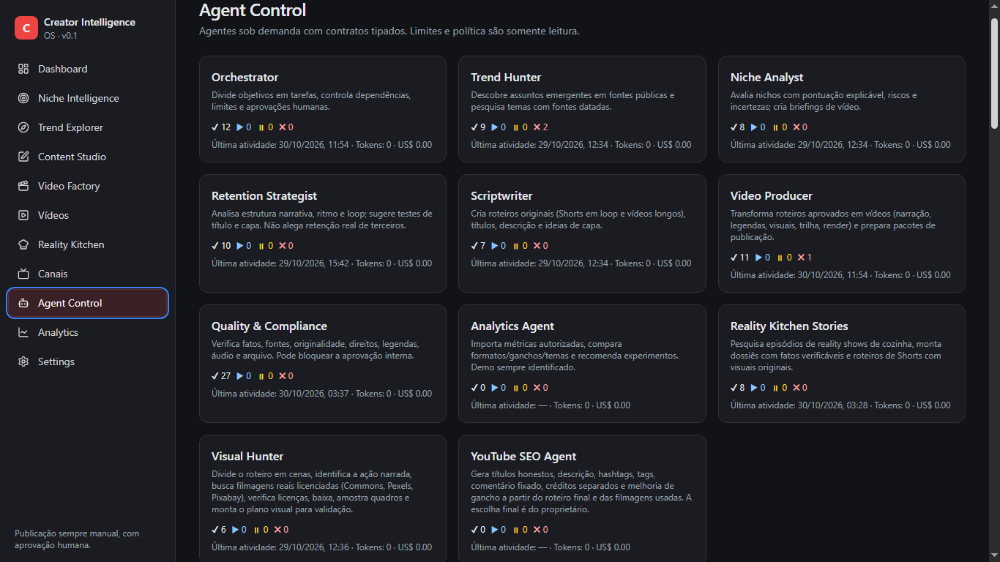

# Creator Intelligence OS

Aplicação local (Windows 10) para pesquisar nichos do YouTube, planejar e roteirizar Shorts em pt-BR,
produzir vídeos localmente com FFmpeg, verificar qualidade/direitos e organizar aprovações.
**Nada é publicado automaticamente.**

Documentos: [AGENTS.md](AGENTS.md) · [SPEC.md](SPEC.md) · [ARCHITECTURE.md](ARCHITECTURE.md) ·
[TASKS.md](TASKS.md) · [DECISIONS.md](DECISIONS.md) · [docs/MONETIZATION.md](docs/MONETIZATION.md)

## Telas

**Dashboard**: projetos, tarefas, vídeos produzidos, erros, custo estimado e aprovações pendentes.


**Niche Intelligence**: ranking explicável de nichos (0–100), com metodologia, pesos e limitações.



**Trend Explorer**: assuntos mais acessados na Wikipedia por idioma, com atalho para criar um Short.


**Vídeos**: biblioteca com prévia, status (pronto para postar / publicado) e resultados.


**Agent Control**: agentes, contagem de tarefas, última atividade e custo.


## Requisitos
- Windows 10, Python 3.12, Node.js 20+ (testado com 24.21), Git.
- FFmpeg **não** precisa estar instalado: o pacote `imageio-ffmpeg` traz o binário (ou defina `FFMPEG_PATH`).
- Narração offline usa as vozes do Windows (Microsoft Maria pt-BR).

## Instalação (PowerShell, na raiz do projeto)
```powershell
py -3.12 -m venv backend\.venv
backend\.venv\Scripts\python.exe -m pip install -r backend\requirements.txt
cd frontend; npm install; npm run build; cd ..
Copy-Item .env.example .env   # edite WIKIMEDIA_USER_AGENT com seu contato
```

## Executar
```powershell
cd backend
.venv\Scripts\python.exe -m uvicorn app.main:app --host 127.0.0.1 --port 8000
```
Abra **http://localhost:8000** (frontend compilado servido pelo FastAPI).

Desenvolvimento com recarga: backend como acima (opcionalmente `--reload`) e, em outro terminal,
`cd frontend; npm run dev` → **http://localhost:5173** (proxy para a API).

## Testes
```powershell
cd backend; .venv\Scripts\python.exe -m pytest -q     # inclui render real de um Short
cd frontend; npm test
```

## Fluxo principal
1. **Niche Intelligence → Executar pesquisa**: ranking pt/en + coleta de tendências (Wikimedia).
2. **Content Studio → Novo Short**: tema (sugestões da Wikipedia), nicho e tom (cômico/educativo/criativo).
   O orquestrador gera briefing, roteiro em loop, notas de retenção e revisão factual.
3. Edite o roteiro (a edição dispara nova revisão) e **aprove** em Video Factory ou no Dashboard.
4. A produção roda localmente (narração, legendas, quadros, trilha, FFmpeg) e passa pelo QA técnico.
5. **Aprovação final** → pacote em `output/publish/<job>/` (vídeo, SRT, metadata.json, CHECKLIST.md)
   para publicação **manual** no YouTube Studio.

**Reality Kitchen Stories**: Atualizar catálogo → Criar dossiê de um episódio → verificar fatos na fonte
(ou adicionar fatos com fonte) → Gerar roteiro e Short. Etapas sem fonte ficam ausentes; cenas de
terceiros sem licença registrada bloqueiam a renderização.

## Saídas
| Pasta | Conteúdo |
|-------|----------|
| `output/reports/` | Relatórios de nichos (`.md` + `.json`) |
| `output/videos/<job>/` | `short_vertical.mp4`, `captions.srt`, `narration.wav`, `music.wav` |
| `output/publish/<job>/` | Pacote para publicação manual |
| `data/cios.db` | Banco SQLite (tarefas, roteiros, cache de pesquisa) |

## Analytics
Importe o CSV exportado do YouTube Studio (Analytics → Avançado → Exportar). Colunas reconhecidas em pt
ou en (ex.: `Content`, `Video title`, `Duration`, `Views`, `Impressions click-through rate (%)`,
`Average percentage viewed (%)`). Sem dados reais, a página mostra estado vazio. O modo demonstração usa dados
sintéticos marcados como DEMO.

## Solução de problemas
- **403 da Wikipedia**: defina `WIKIMEDIA_USER_AGENT` com um contato (política de robôs da Wikimedia).
- **Porta 8000 ocupada**: `--port 8010` e ajuste o proxy em `frontend/vite.config.ts`.
- **Narração muda/silenciosa**: verifique as vozes em Configurações do Windows → Fala; ou use `TTS_PROVIDER=silent`.
- **Tarefa falhou**: Agent Control mostra o erro; em Video Factory use “Repetir etapa com falha”.
- **Frontend desatualizado em :8000**: rode `npm run build` novamente.

## Limitações conhecidas
- Demanda medida por pageviews da Wikipedia (proxy), não por buscas no YouTube. Sem `YOUTUBE_API_KEY`,
  concorrência é hipótese.
- Roteiros do provedor `template` reaproveitam frases das fontes (CC BY-SA). O QA sinaliza e o texto deve
  ser reescrito antes de publicar. O provedor LLM (modo híbrido) ainda não foi implementado.
- Voz SAPI é robótica, e sua licença para uso comercial precisa ser verificada pelo proprietário.
- Visuais são cartões tipográficos gerados localmente (sem imagens de terceiros).
